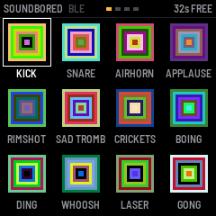

# soundbored

Third-party firmware for the M-VAVE FM-1 that turns it into a soundboard. A web page sends short mono samples to it
over USB MIDI, each with a name and an icon. The screen shows them as a grid of icons, and the keys play them. You add,
rename, re-key and delete sounds from the page without reflashing.

It is built on [fm1-base](https://github.com/charlesvestal/fm1-base) (in `base/`) and felucca-bsp.



> **Status:** the firmware passes its simulator tests, and the web page has been cross-checked against the simulator.
> Neither has been tried on real hardware or with a real FM-1 in a browser yet.

## Firmware features

- **An icon grid:** 12 sounds a page (4×3), 4 pages, 48 sounds in all. Each cell shows a 48×48, 16-colour icon and a
  name of up to 16 characters.
  - The white frame is the cursor.
  - An amber frame means the sound is playing.
  - The top bar shows Bluetooth, the page and the seconds of sound still free.
- **Playback:**
  - 8 voices, mixed and resampled to 44.1 kHz.
  - Velocity sets the volume, on top of each sound's own gain.
  - Each sound has a mode: **one-shot** (a press restarts it), **gate** (plays while held) or **loop** (a press starts
    it, the next press stops it).
- **Keys and MIDI:** each sound can be bound to one of the 27 keys. MIDI note 53 (F3) plays the lowest key, up to
  note 79, on any channel, from USB, Bluetooth or the TRS jack.
- **Controls:**

  | Control | What it does |
  | --- | --- |
  | A key | Plays its sound |
  | SELECT | Moves the cursor |
  | PRESET / ALGO / OCT− / OCT+ | Turn the page |
  | SEL / PLAY | Play the cursor's sound |
  | HOME | Stops everything |
  | REC, held 1 s | Turns Bluetooth off or on |
  | MASTER | Volume |

- **Storage:** sounds live in the FM-1's flash, 94 sectors of 3840 bytes: about 45 seconds at 16 kHz. They survive
  power-off and firmware updates of soundbored itself. Installing other firmware may overwrite them.
- **Uploads are safe to interrupt.** A sound only appears once its CRC-32 has been checked against what was read back
  from flash. Lost replies are resent, and the device answers a resend from its cache.

The full manual is [app/docs/MANUAL.md](app/docs/MANUAL.md), and the USB protocol is
[docs/protocol.md](docs/protocol.md).

## Start the GUI

You need Node.js 18 or later, and Chrome or Edge (Web MIDI with SysEx). From the repo root:

```bash
npm run setup     # once: installs web/'s dependencies
npm run dev       # serves the page with hot reload
```

Open <http://localhost:5173>, connect the FM-1 by USB, click **Connect via Web MIDI** and allow SysEx when the browser asks, then pick the FM-1's ports and click **Connect**.

- **No FM-1?** Click **Use Simulated FM-1**. It's an in-browser device that speaks the same protocol and keeps its
  sounds in localStorage.
- **WSL2:** run `npm run dev` in WSL and open `http://localhost:5173` in Windows Chrome. Use `localhost`, not the
  `Network:` address Vite prints: Web MIDI SysEx needs a secure context, and only `localhost` counts as one over plain
  HTTP. The FM-1 stays a Windows USB device; no usbipd is needed for the browser.

On the page, drop an audio file (WAV, MP3, OGG, FLAC, M4A…) and an image onto a slot. The page:
1. trims, normalises and converts the audio to the device's format
2. turns the image into an icon
3. uploads both

The same page renames sounds, changes icons, keys, modes and gain, swaps slots, previews and deletes. See
[web/README.md](web/README.md) for its internals.

## The sound format

A sound on the device is an **icon** followed by **audio**, with a little metadata: name, sample rate, frame count,
key, mode and gain. The page builds this from ordinary files, but you can make the two parts yourself.

### Audio: mono IMA ADPCM, headerless

| | |
| --- | --- |
| Channels | 1 (mono) |
| Sample rate | 4000..44100 Hz. 16000 is the default and the best trade of quality against space (8000 bytes a second) |
| Encoding | IMA ADPCM, 4 bits a sample: the standard 89-entry step table and index table (−1 −1 −1 −1 2 4 6 8) |
| Start state | predictor 0, step index 0. There are no block headers: the whole sound is one stream |
| Nibble order | the first sample of each byte is in the **low** nibble |
| Size | `audio_bytes` = ceil(`frames` / 2) |

This is not the same as the blocked `.wav` IMA ADPCM that ffmpeg or sox write (those have per-block headers), so
encode it with `tools/sbtool.py`, below.

### Icon: 1184 bytes

| Offset | Size | What |
| --- | --- | --- |
| 0 | 32 | The palette: 16 colours, each RGB565 as a little-endian u16 |
| 32 | 1152 | 48×48 pixels as 4-bit palette indexes, row by row from the top. 2 pixels a byte, the **high** nibble is the left pixel |

### Example: making both with open-source tools

[ffmpeg](https://ffmpeg.org) or [SoX](https://sourceforge.net/projects/sox/) prepare the audio,
[ImageMagick](https://imagemagick.org) prepares the image, and `tools/sbtool.py` (in this repo, MPL-2.0, run with
[uv](https://docs.astral.sh/uv/)) writes the device's formats.

```bash
# 1. Audio: any file to a 16 kHz mono 16-bit WAV (either tool)
ffmpeg -i airhorn.mp3 -ac 1 -ar 16000 -c:a pcm_s16le airhorn.wav
sox airhorn.flac -c 1 -r 16000 -b 16 airhorn.wav

# 2. WAV to headerless IMA ADPCM (prints the rate and frame count that go in the metadata)
uv run tools/sbtool.py encode airhorn.wav airhorn.adpcm
#   rate=16000 frames=24000 audio_bytes=12000 (1.50 s)

# 3. Listen to what the device will play
uv run tools/sbtool.py decode airhorn.adpcm 16000 check.wav

# 4. Icon: crop and scale to 48x48 with ImageMagick, then pack to 16 colours
magick horn.jpg -resize 48x48^ -gravity center -extent 48x48 horn48.png
uv run tools/sbtool.py icon horn48.png airhorn.icon      # 1184 bytes
uv run tools/sbtool.py unicon airhorn.icon preview.png   # check what it will look like
```

`sbtool.py encode` reads 8, 16, 24 or 32-bit PCM WAVs at 4000..44100 Hz and mixes stereo down, so step 1 is only
needed for other formats or rates. `sbtool.py icon` crops and scales any image Pillow can read, so step 4's ImageMagick
pass is optional. If you have ImageMagick 6, the command is `convert` instead of `magick`.

To send the result to the device, upload `icon + audio` as one stream (`BEGIN`, `DATA`, `COMMIT`), as
[docs/protocol.md](docs/protocol.md) describes.

## Building and installing the firmware

Building needs JieLi's toolchain and the AC79 SDK. See [app/README.md](app/README.md):

```bash
export AC79_SDK=~/fw-AC79_AIoT_SDK JIELI_TOOLCHAIN=~/.jieli/toolchain
uv run base/tools/build.py app        # app/build/soundbrd.fwsc
```

Install it with fm1-base's installer page or `base/tools/fm1_install.py`. Back up the FM-1 first, with
`base/tools/fm1_backup.py`.

## Development

All from the repo root:

| Command | What it does |
| --- | --- |
| `npm run dev` | The web page, with hot reload |
| `npm run build` / `npm run preview` | Production build into `web/dist/` / serve that build |
| `npm test` / `npm run check` | The web page's unit tests / type check |
| `npm run test:fw` | Builds the firmware for the host simulator and runs its checks |
| `npm run xcheck` | Runs the web page's protocol code against the firmware in the simulator |
| `uv run tools/sbtool.py selftest` | Checks sbtool's framing, CRC and ADPCM |

| Path | What |
| --- | --- |
| `app/` | The firmware: `app.c`, `app.h`, `fm1.toml`, tests, manual |
| `web/` | The uploader: Vite, TypeScript, Svelte 5 |
| `docs/protocol.md` | The SysEx protocol: the contract between the two |
| `tools/` | `sbtool.py` (the protocol and formats in Python) and `xcheck.sh` |
| `base/` | fm1-base |

## License

MPL-2.0. See [LICENSE](LICENSE). fm1-base's own licensing is in [base/LICENSING.md](base/LICENSING.md).
