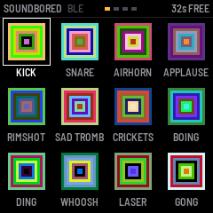
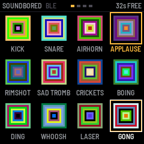

# SOUNDBORED manual

SOUNDBORED turns the FM-1 into a soundboard. The screen shows your sounds as a grid of icons, 12 to a page and up to
48 in all. Press a key and its sound plays. You add, rename and delete sounds from a web page over USB, and you never
have to reflash.

## The screen

- **The top bar** shows the name, BLE when Bluetooth is on (lit while a computer is connected), the page as four dots,
  and how many seconds of sound still fit at 16 kHz.
- **The grid** shows the page's 12 sounds as icons with names. Empty slots show their number.
  - The white frame is the cursor.
  - An amber frame means the sound is playing.

## Controls

| Control | What it does |
| --- | --- |
| A key | Plays the sound bound to it. Keys with a sound glow dimly, and they light up while it plays. |
| SELECT | Moves the cursor, from page to page. |
| PRESET or ALGO, OCT− / OCT+ | Turns the page. |
| SEL or PLAY | Plays the cursor's sound. |
| HOME | Stops every sound. |
| REC, held for a second | Turns Bluetooth off or on. It stays that way after a restart. |
| MASTER | Sets the volume. |

Each sound has a **mode**:
- **One-shot** plays to its end. Pressing again starts it over.
- **Gate** plays while you hold the key.
- **Loop** repeats until the next press.

How hard you press the key sets the volume.

**MIDI** also plays sounds. Note 53 (F3) plays the sound on the lowest key, note 54 the next key up, and so on to
note 79, on any channel, from USB, Bluetooth or the TRS jack.

## Adding sounds

Open the soundbored web page in Chrome or Edge, with the FM-1 connected by USB. Then drop an audio file and an
image onto it. The page:
- converts the audio to mono 16 kHz ADPCM (about 8 KB per second), trimming and normalising it
- turns the image into a 48×48, 16-colour icon
- sends both to the FM-1

The same page renames sounds, changes their icons, keys and modes, moves them around the grid, and deletes them.

Sounds are kept in the FM-1's flash, about 45 seconds in all. They survive power-off. Updating SOUNDBORED keeps them,
but installing other firmware may overwrite them.

## For developers

The USB protocol is in `docs/protocol.md` at the root of the repository. `tools/sbtool.py` speaks it from Python.
